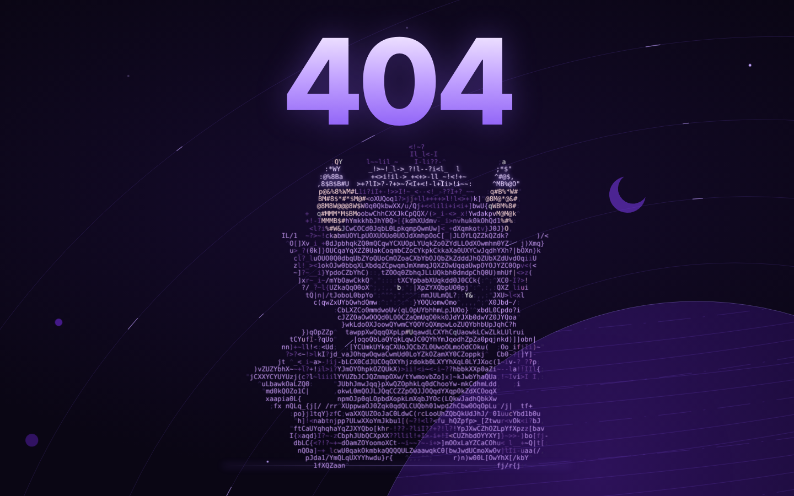

# 404 · Pars

A 404 page with nothing on it but **404** and **Pars** — an original character rebuilt from lines of code.

## How it works

- **Pars in code lines** — the artwork is converted into colored ASCII: every cell is a character,
  every character keeps the color of the pixel underneath.
- **Steady 404** — a plain, purple `404` at the top that never moves or animates.
- **The loop** — Pars sits below it and follows the terminal-header SVG timing (24.46 s,
  keyTimes `0 · .0164 · .2003 · .9673 · .9988 · 1`): a scan beam draws him top-to-bottom →
  he stays → he collapses → repeat.
- **Pars is never still**
  - rows near the cursor ripple sideways and glow purple
  - characters rewrite themselves now and then, like live code
  - click / tap Pars and he shakes off the whole code layer
  - with no mouse (or on mobile) an invisible cursor drifts over him
- **Thin purple lines** — orbit lines with moving dashes and a hatched planet. The background moves
  on its own; the planet's surface drifts slowly while the planet itself stays in place.
- **No links** — the page is only a 404; nothing on it navigates anywhere.
- Zero dependencies, one HTML file, `prefers-reduced-motion` respected.

## Use it

| Host | What to do |
|---|---|
| GitHub Pages | keep `404.html` in the site root (it's identical to `index.html`) |
| Netlify / Vercel / Cloudflare Pages | put `404.html` in the output folder |
| Nginx | `error_page 404 /404.html;` |
| Apache | `ErrorDocument 404 /404.html` |

## Türkçe

Ekranda yalnızca **404** ve **Pars** var. Üstte sabit, mor bir 404; altında oturan Pars,
orijinal çizimden kod satırlarına çevrildi ve terminal header SVG'sindeki döngüyle (24.46 sn)
çiziliyor, bekliyor, kapanıyor ve tekrar başlıyor. İmleç yaklaşınca Pars'ın satırları mor parlayarak dalgalanıyor,
tıklayınca kod katmanını silkeliyor. Arkada ince mor yörünge çizgileri ve çizgili bir gezegen var.

## License

Code: [MIT](LICENSE). The **Pars** character and artwork are © Ali Gökdam — not to be reused without permission.
